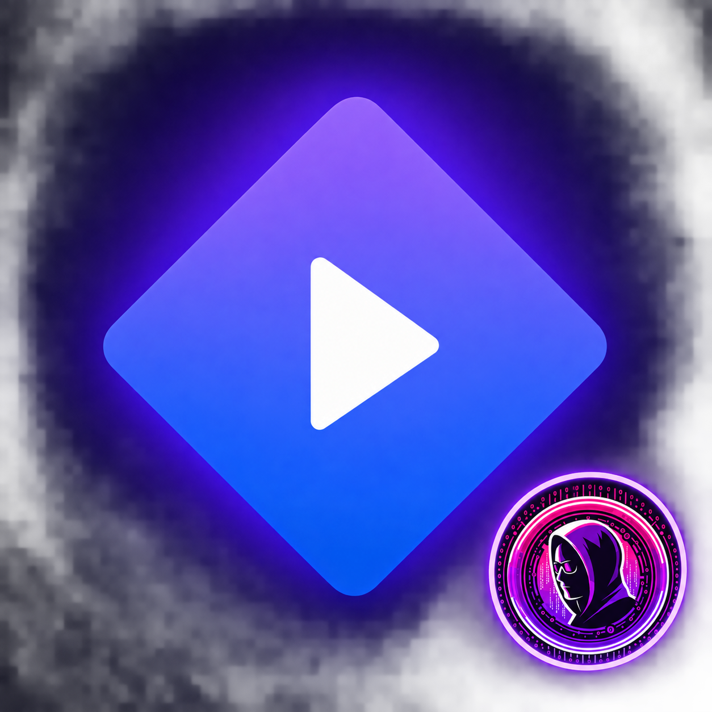

# Unofficial Stremio PS5 Port — PS4 Adaptation

<p align="center">
  
</p>

<p align="center">
  A native PS4 port of Sp9nky's unofficial Stremio PS5 client.
</p>

> [!IMPORTANT]
> This PS4 adaptation is maintained by **Tahar Chtioui
> ([@JavaScript-X](https://github.com/JavaScript-X))** and is based on
> **Sp9nky's [unofficial Stremio PS5 port](https://github.com/Sp9nky/unofficial-stremio-ps5-port)**
> and its contributors. It is not affiliated
> with or endorsed by Stremio, Smart Code OOD, Sony, or PlayStation. Only use
> addons and media that you are legally authorized to access.

## Project status

Version **9.10** continues the PS5-to-PS4 port and is under active development on
the `codex/stremio-ps5-to-ps4-port` branch. It has been built
for a real PS4
running firmware **13.02 with GoldHEN**. It is not a finished consumer release.
Back up important console data and expect compatibility differences between
firmware, payload, media container, codec, and addon combinations.

The ported executable now includes:

- A new OpenOrbis entry point and application state machine.
- A new Sony platform layer for UserService, Pad, VideoOut, system IME,
  notifications, Net, SSL, and HTTP.
- A PS4-native adaptation of the PS5 port's Board, Discover, Library, Addons,
  Settings, title details, search, focus rail and loading experience.
- A semantic theme-token system, persistent compact navigation rail, expanded
  focus overlay, white focus rings, big-screen typography, and state-driven
  rendering informed by EVO Player's public UI architecture.
- A new isolated Stremio service that retrieves Cinemeta catalogs, search
  results, and metadata.
- The upstream Inter UI font, Stremio branding, navigation and controller
  glyphs, Glass interface sounds, certificates, and bundled license notices.
- Live Cinemeta/MetaHub posters and a full-screen board backdrop, decoded and
  cached in PS4-native memory.
- A minimal executable with none of the old shell, playback tests, media
  samples, demuxers, or legacy application controller linked into it.

This repository is a fork of the upstream GPL project. Its original PS5
OpenGL, VideoDec, audio and runtime modules remain in the root source tree as
porting references but are not linked into the PS4 binary. The imported base
revision is recorded in `UPSTREAM_REVISION`; these modules require
PS4/OpenOrbis implementations rather than binary reuse.

The previous application included:

- Native 1920×1080 OpenOrbis interface with DualShock 4 navigation.
- Android TV-inspired hero layout, expandable sidebar, and continuous catalog.
- Movies, series, public-domain content, search, details, and episode selection.
- Stremio device-link authentication and synchronized addon endpoints.
- Cached posters, wallpapers, title logos, metadata, and stream results.
- Torrent resolution through the official Stremio server on the local network.
- Direct Videodec2 H.264 playback with companion HLS audio through AVPlayer.
- Player HUD, pause, restart, fit/fill modes, and audio-sync adjustment.
- Packaged playback diagnostics for 360p, 480p, 720p, and 1080p sources.

Still planned or incomplete:

- Broad container and codec coverage, including reliable MKV/HEVC handling.
- Subtitles, library synchronization, Continue Watching, and progress sync.
- Multiple audio/subtitle-track selection and long-session recovery testing.
- Compatibility testing across more PS4 firmware and jailbreak environments.

## Architecture at a glance

The PS4 application owns the interface, account/addon client, caching, input,
and hardware playback. Torrent transport remains in the official Stremio server
running on a PC or NAS. Addons remain remote HTTP services; the PS4 does not
download or execute addon code.

```text
Stremio account and addon services
                |
                v
       Native PS4 application
       UI / cache / Videodec2
                |
                v
 Official Stremio companion on LAN
 torrent resolution / HLS delivery
```

See [Architecture](docs/architecture.md) for component and trust-boundary
details, [Roadmap](docs/roadmap.md) for priorities, and
[Console testing](docs/testing-m0.md) for the real-hardware checklist.

## Requirements

- A jailbroken PS4 capable of installing homebrew PKGs.
- GoldHEN or another compatible homebrew environment.
- Docker Desktop for the recommended reproducible build.
- The official Stremio server on a PC/NAS for torrent-backed streams.
- A legally obtained OpenOrbis toolchain when building without Docker.

No Sony SDK files or credentials are included in this repository.

## Build

### Reproducible Docker build

```powershell
./scripts/fetch-openorbis.ps1
docker compose build builder
docker compose run --rm builder
docker compose run --rm packager
```

The package is written to:

```text
dist/IV0000-BREW00100_00-STREMIOPS4000000.pkg
```

### Existing OpenOrbis installation

```sh
export OO_PS4_TOOLCHAIN=/path/to/OpenOrbis-PS4-Toolchain
make check
make
make package
```

The build uses OpenOrbis `_common/graphics.cpp` and runtime assets from the
configured toolchain. If your installation uses different paths, provide
`RIGHT_SPRX` and `ICON0` explicitly to `make`.

## Companion server

Start the official Stremio server on a computer connected to the same network:

```sh
docker compose -f docker-compose.companion.yml up -d
```

Allow TCP ports `11470` and `12470` through the computer firewall. In the PS4
application, open **Settings → Companion Server** and enter the computer's LAN
address, for example `192.168.1.50:11470`. Keep the companion available while
resolving and streaming torrent-backed sources.

## Controls

### Catalog and navigation

- **D-pad / left analog stick:** navigate menus, catalogs, and lists.
- **Left at the beginning of a catalog:** open the sidebar.
- **Right / Cross in the sidebar:** close it and return to content.
- **L1 / R1:** change the active main section.
- **Cross:** open the selected title, episode, setting, or stream.
- **Circle:** return to the previous screen.
- **Triangle:** reload supported catalog/search data.

### Version 9.00 port controls

- **Cross:** select a page or title.
- **Circle:** return from details or close the navigation rail.
- **Triangle / Options:** open the PS4 system search keyboard.
- **D-pad / left stick:** navigate rows, grids and the five-page rail.
- **Left at the first item:** move focus into the rail.
- **Right / Cross in the rail:** open the selected page.

## Data and privacy

Account tokens, cached metadata, artwork, stream results, and settings are
stored in the application's private `/data` directory. Tokens must never be
committed or included in diagnostic reports. Addon responses and media URLs are
untrusted and are processed with bounded downloads and scheme checks.

## Test media and third-party material

The bundled Gontserrat font is distributed under the SIL Open Font License.
Stremio and PlayStation names and marks belong to their respective owners.

## Contributing

Keep changes focused, document hardware results, and never commit credentials,
copyrighted commercial media, Sony SDK files, generated PKGs, or private keys.
A useful report includes firmware, jailbreak version, package checksum, source
type, codec/container, visible behavior, FPS, and exact diagnostic error code.

## License

The PS5-to-PS4 derivative on `codex/stremio-ps5-to-ps4-port` is licensed under
**GNU GPL v3.0 or later**; see [COPYING.PS5-PORT](COPYING.PS5-PORT). The
historical original PS4 work remains covered by its root [PolyForm license](LICENSE).
See [PS5 port credits](PS5_PORT_CREDITS.md) for the required upstream
attribution to Sp9nky, the upstream contributors and their dependencies.
